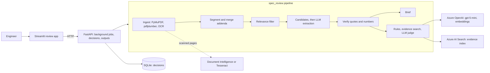
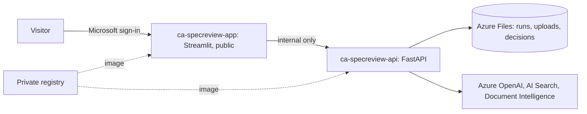

# Spec Review Copilot

An AI assistant that reads municipal water and wastewater bid packages for an equipment manufacturer. It finds
the few sections that matter in a package of hundreds of pages and extracts every requirement with its exact
page. It checks each requirement against the product's capabilities and drafts the bid outputs. An engineer
approves every item; nothing is final until they do.

This is a one-week interview prototype, a proof of value rather than a product. It runs only on public and
synthetic data, and it measures its own accuracy. The core problem it works on: **never miss a requirement in a
long package, and prove where every item came from.**

## The problem

A proposal engineer at an equipment maker reads a bid package of RFP, specifications, addenda and permits to
answer three questions: which requirements apply to our equipment, can we meet them, and what must we say in
the bid? These are what go wrong:

- **Time:** hundreds of pages are read to find a few relevant sections.
- **Missed requirements:** a requirement buried deep in the package is missed at bid time and becomes a cost
  after award.
- **Disqualification:** a missed form, deadline, or mandatory requirement makes the bid non-responsive.
- **Specs written around a competitor:** these must be challenged during the clarification window.
- **Addenda:** they change requirements and dates after the RFP is issued.

## What it does

| Step | What happens |
|---|---|
| Read | Text, tables, and OCR for scanned pages. Sections are split by CSI MasterFormat and older numbering. Addenda are merged, newest wins, and every change is logged. |
| Filter | A product map keeps the sections that matter. When unsure it keeps the section and logs why (recall beats precision). |
| Extract | Rules flag candidate sentences, and an LLM turns them into structured requirements. Every quote and number is checked against the page. Each candidate ends as a requirement or as "not a requirement" with a reason: nothing is dropped silently. |
| Brief | Deadlines, required forms, red flags (for example a named competitor or a sole source), and permit limits, each with its page. |
| Match | Rule checks first. Then evidence search over capability rows, past exceptions, and product brochures. Then an LLM judge gives comply, clarify, deviation, needs engineer, or not applicable, with a reason, a confidence, and the evidence it used. Low confidence goes to the engineer. |
| Review | A Streamlit app with Brief, Checklist, Source viewer (the cited page with the quote highlighted), and Addenda changes. The engineer's decision is stored with their name and time. |
| Outputs | An Excel compliance matrix, a marked-up PDF with C, D, and R notes, an exceptions and clarifications letter (docx), a clarification questions list, and an addendum diff report. |

Every requirement and every match result cites a document and page. No citation, no record.

## Architecture



- **Stages:** each stage is its own package under `spec_review/`. The contract between stages is the Pydantic
  models in `spec_review/models.py`. Every stage writes `runs/<run_id>/<stage>.json`, so each step can be
  inspected.
- **LLM calls:** all of them go through `spec_review/llm/client.py`. Each call is logged with tokens, latency,
  and cost, and its reply is cached on disk. A repeated run of the same package costs $0.
- **Prompts:** they are versioned files (`extract_v2`, `judge_v4`, …). A new version is a new file.
- **Providers:** they are chosen in `.env`.
  - **Mock** is the default: deterministic fixtures for the tests, which need no network and no keys.
  - **Azure:** Azure OpenAI, Document Intelligence, and AI Search.
  - **Local:** Tesseract and an in-memory index.

## Results

The scored config is frozen in [`docs/FREEZE.md`](docs/FREEZE.md) (tag `phase4-freeze`), and
`tests/test_freeze.py` fails if it drifts. The full scorecards and the analysis are in
[`docs/scorecards/`](docs/scorecards/README.md).

| Metric | Test: Cedar Falls (held out) | Dev: Lakeview | Target |
|---|---|---|---|
| Section filter recall | 1.0 | 1.0 | 100% |
| Silent drops | 0 | 0 | zero |
| Mandatory requirement recall | **0.948** | 0.964 | at least 95% |
| Requirement recall / precision | 0.950 / **0.162** | 0.966 / 0.702 | |
| Citation accuracy | 1.0 | 1.0 | at least 98% |
| Deadline / required form recall | 1.0 / 1.0 | 1.0 / 1.0 | 100% |
| Red flag recall | **0.857** | 1.0 | |
| Planted traps caught | 7 of 7 | 7 of 7 | |
| Status accuracy (matched requirements) | 0.797 | 0.826 | |
| Cost of one run | $1.14 (120 pages) | $0.44 uncached (154 pages) | |

**Read these numbers with care:**

- **Both packages are synthetic, from the same builder.** The real public packages (Manor, Sandy, Avila Beach)
  couldn't be hand-labeled without inside knowledge. So on 2026-11-01 the owner decided the test set would be
  one synthetic package, Cedar Falls.
  - It was written after the freeze, and its labels come only from its generator.
  - The pipeline never ran on it before the single test run.
  - It measures how the frozen config carries over to new text from the same author. It doesn't measure
    accuracy on real bids.
- **The test run failed two eval gates, and it is reported as it came out.**
  - Candidate recall was 0.993: one paragraph of a reissued section was missed.
  - Red flag recall was 0.857: "no substitutions will be considered" matched no sole-source pattern.
- **Precision is the weak point.** Three out-of-scope sections named the equipment often and were kept by the
  filter, by design (recall first). They added 461 extra requirements for the engineer to dismiss.
- **Fixes are listed in the scorecard README, not applied.** Tuning on the test set would make it no longer a
  test.
- **The product data is public or invented.** Public datasheets give typical or claimed values, not guarantees.
  So "comply" here means "the public documents say so", and an engineer still decides.

## Run it locally

Needs Python 3.11 and [uv](https://docs.astral.sh/uv/). Tesseract is only needed for scanned pages
(`brew install tesseract`).

```bash
uv sync
uv run pytest                      # all tests pass with no network and no keys (mock mode)
scripts/demo.sh                    # builds the Lakeview sample and runs it end to end in mock mode
```

**For real results,** copy `.env.example` to `.env` and fill in the Azure OpenAI, Document Intelligence, and AI
Search settings. Then:

```bash
uv run python scripts/make_lakeview.py          # the synthetic dev package and its labels
uv run specreview run data/raw/dev/lakeview      # writes runs/<run_id>/
uv run specreview outputs <run_id>               # the five bid outputs
uv run specreview eval dev                       # the dev scorecard
uv run specreview knowledge search "<requirement text>"
```

**The review app:** start the API first, then the app.

```bash
uv run specreview serve                          # API on port 8000
uv run streamlit run app/streamlit_app.py        # app on port 8501
```

**Docker:** `docker compose up --build` runs the API and the app together. With no `.env` it runs in mock mode.
With Azure set in `.env`, the Lakeview sample replays its cached replies at $0. Runs and uploads are kept in
Docker volumes.

[`docs/USER_WORKFLOW.md`](docs/USER_WORKFLOW.md) walks through a full review, with what to expect at each step.

## Hosted demo (Azure Container Apps)

The hosted copy is private. Anyone opening it signs in with a Microsoft account first (Container Apps built-in
sign-in). Then the app admits only the emails the owner allowed; everyone else sees "Ask the owner for access."



- **Deploy:** `AZURE_SUBSCRIPTION_ID=<id> uv run python scripts/deploy_azure.py --allow you@example.edu` creates
  the resources step by step (`base`, `image`, `api`, `app`). Each step can be rerun.
  - Keys from `.env` become Container Apps secrets and are never printed.
  - Local paths stay on your machine.
- **Grant access:** `scripts/grant_access.sh add|remove|list <email>`.
- **The API has internal ingress only,** so only the app can reach it. Hosted mode hides the labeling helper,
  records every decision under the signed-in email, and caps uploads at 25 MB.
- **Cost:**
  - The apps scale to zero and fit the Container Apps free monthly grant at demo use.
  - The registry (Basic) costs about $5 a month, and the file share a few cents.
  - Each uploaded package costs its Azure OpenAI calls (about $1 per 120 pages). The cached Lakeview sample
    costs $0.
  - The first visit after an idle spell waits for the apps to start.
- **Checked on 2026-11-02:**
  - An anonymous browser visit is sent to Microsoft sign-in.
  - The API answers 404 from the internet.
  - Inside the environment, the Lakeview sample ran all 13 stages in 51 seconds. 398 of 398 replies came from
    the cache, so it cost $0, and it found the same 319 items as a local run.
  - All five outputs were generated.
  - After an API restart on a new replica, the run and its output files were still there.

## Repository

```
spec_review/        pipeline stages, LLM client, API, review store, outputs, eval
app/                Streamlit review app (views/ holds one file per page)
scripts/            package generators, downloads, demo, deploy, access
data/sources.yaml   every public source; data/raw/ is gitignored and never committed
data/golden/        labels: dev/lakeview.json, test/cedar_falls.json
docs/               spec, phase prompts, freeze record, scorecards, user workflow
tests/              pytest; mock mode, no network
```

## Limitations

- **Synthetic evaluation:** the test package shares its builder with the dev package, so the scores are
  optimistic for real bids. No real package was scored.
- **Precision:** an engineer dismisses many extra items in long packages. The filter fix is known but not
  applied.
- **Product knowledge:** a small public set of typical values, plus invented capability rows and past
  exceptions. Comply is never a guarantee.
- **One process:** jobs run in a thread inside the API. If the API restarts mid-run, that run is lost. The
  hosted API runs one replica, because SQLite has a single writer.
- **Access by email:** the allowlist trusts the account name that Microsoft sign-in reports. Production should
  key access on tenant and object IDs.
- **The labeling helper** is local only. The deviations log `review_exceptions.csv` lives in the container and
  is not kept across hosted restarts; the decisions themselves are.

## What production would need

- Guaranteed product data from engineering, and past bids from the company's own systems.
- Real packages labeled by proposal engineers, plus an eval set for each engineering firm's style.
- Single sign-on with roles, and an audit trail of who decided what.
- Durable jobs (a queue and workers), Postgres instead of SQLite, and blob storage for packages.
- The filter, extraction, and red-flag fixes in the scorecard README, measured on a fresh test set.
- Monitoring of cost, latency, and how often engineers overturn the AI's status.
