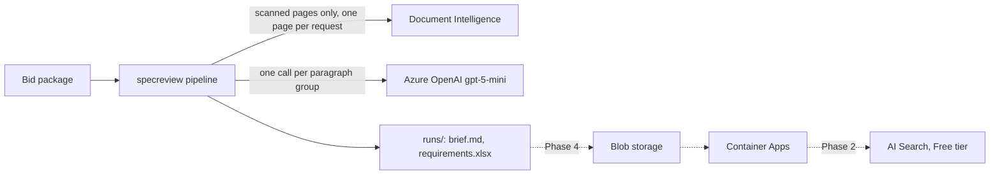

# Azure: setup, costs, and guardrails

Since 2026-10-29 the project runs on Azure for everything. Tests never touch Azure: they run offline in mock mode, with no keys. Only real runs use the services below. The old Explorer cluster guide is in [EXPLORER.md](EXPLORER.md); nothing here depends on it.

## What runs on Azure

| Service | Used for | Phase | Bills by |
|---|---|---|---|
| **Azure OpenAI** chat, deployment `gpt-5-mini` | Requirement and permit-limit extraction | 1b | Tokens |
| **Document Intelligence**, prebuilt-read model, free F0 tier | OCR of scanned pages only | 1b | Pages; 500 free a month |
| **Azure OpenAI** embeddings, `text-embedding-3-small` | Knowledge-base vectors | 2 | Tokens |
| **Azure AI Search**, Free tier | Evidence search | 2 | Nothing on the Free tier |
| **Container Apps**, consumption plan | Hosting the app and API | 4 | Usage above a monthly free grant |
| **Blob storage** | Runs, files, review database | 4 | Storage, in cents |

Nothing in Phase 1b bills by the hour.



## Names

Every resource follows Microsoft's [Cloud Adoption Framework naming convention](https://learn.microsoft.com/en-us/azure/cloud-adoption-framework/ready/azure-best-practices/resource-naming): `<type>-<workload>-<environment>-<region>`. The type prefixes come from Microsoft's [abbreviation list](https://learn.microsoft.com/en-us/azure/cloud-adoption-framework/ready/azure-best-practices/resource-abbreviations). The workload is `specreview`, the environment is `demo`, and the region code here is `gwc` (Germany West Central). Azure for Students only allows a few regions (see "Region" below); change the code if you deploy elsewhere.

| What | Name | Phase |
|---|---|---|
| Resource group | `rg-specreview-demo-gwc` | 1b |
| Foundry resource (hosts the OpenAI models) | `aif-specreview-demo-gwc` | 1b |
| Foundry project | `proj-specreview-demo` | 1b |
| Chat deployment | `gpt-5-mini` | 1b |
| Embedding deployment | `text-embedding-3-small` | 2 |
| Document Intelligence resource | `di-specreview-demo-gwc` | 1b |
| Budget | `budget-specreview-demo` | 1b |
| AI Search service | `srch-specreview-demo-gwc` | 2 |
| Search index | `idx-capabilities` | 2 |
| Storage account | `stspecreviewdemo` (lowercase, no hyphens, 3–24 characters) | 4 |
| Blob containers | `packages`, `runs`, `reviews` | 4 |
| Log Analytics workspace | `log-specreview-demo-gwc` | 4 |
| Container Apps environment | `cae-specreview-demo-gwc` | 4 |
| Container apps | `ca-specreview-api`, `ca-specreview-app` | 4 |
| Container images (GitHub Container Registry) | `ghcr.io/hemanthrayuduu/spec-review-copilot-api`, `…-app` | 4 |

- **Global uniqueness:** the Foundry resource, Document Intelligence, AI Search, and storage names become public hostnames, so they must be unique across Azure. If one is taken, add a short suffix, for example `aif-specreview-demo-gwc-01` or `stspecreviewdemo01`.
- **Deployment names match the model name,** so `.env` reads plainly.
- **Tags:** put these on the resource group, so every resource inherits them and the cost view groups cleanly:

  | Tag | Value |
  |---|---|
  | `project` | `spec-review-copilot` |
  | `environment` | `demo` |
  | `owner` | your Northeastern email |
  | `data` | `public-synthetic` |
  | `cost-center` | `azure-for-students` |

## Region

The Azure for Students subscription has an **"Allowed resource deployment regions"** policy. Creating anything outside it fails with `RequestDisallowedByAzure`, which is what happened with East US. Checked on 2026-10-31:

| Allowed region | gpt-5-mini Global Standard | gpt-5-mini quota | Document Intelligence F0 |
|---|---|---|---|
| **Germany West Central** (chosen) | yes | 500 capacity units | yes |
| Norway East | yes | 500 | yes |
| Spain Central | yes | 500 | no |
| Canada Central | no (provisioned only, bills by the hour) | — | — |
| Denmark East | no (models not offered) | — | — |

- **gpt-5.4-mini** has 0 quota in every allowed region, so it is not an option without a quota request.
- **Pick the subscription explicitly.** The account's default subscription is "SPS Shared Services", a Northeastern subscription. Pass `--subscription "Azure for Students"` to every `az` command, or run `az account set --subscription "Azure for Students"` first.

To re-check:

```bash
az policy assignment list --subscription "Azure for Students" --query "[].parameters.listOfAllowedLocations.value" -o json
az cognitiveservices usage list --subscription "Azure for Students" --location germanywestcentral \
  --query "[?contains(name.value,'gpt-5-mini')]" -o table
```

## Setup, done once by you

1. **Create the resource group** `rg-specreview-demo-gwc` with the tags above. In [Microsoft Foundry](https://ai.azure.com) (formerly Azure AI Foundry), create a Foundry resource named `aif-specreview-demo-gwc` in that group, with a project named `proj-specreview-demo`. Deployments live on the resource; the project is where you deploy and test them in the portal. The pipeline calls the resource's endpoint, never the project's. Use **Germany West Central** for everything (see "Region").
2. **Deploy `gpt-5-mini`**:
   - deployment type **Global Standard**;
   - deployment name **`gpt-5-mini`**;
   - note the tokens-per-minute (TPM) quota it shows, since that sets how long a large package takes (see "Quota" below).
3. **Create a Document Intelligence resource** named `di-specreview-demo-gwc`, on the **F0 (free)** tier, in the same group. This step is optional: without it, `PROVIDER_OCR=local` uses Tesseract.
4. **Set budget alerts:** a budget named `budget-specreview-demo`, with alerts at $25, $50, and $75, under Cost Management. They only notify you; they don't stop spending. On a new subscription they can take up to 48 hours to become available. The Azure for Students subscription itself stops when the $100 credit runs out ([Azure for Students costs](https://learn.microsoft.com/en-us/azure/education-hub/navigate-costs)).
5. **Fill in `.env`.** Copy `.env.example` to `.env` (it's gitignored), then set:

   ```
   PROVIDER_LLM=azure
   PROVIDER_OCR=azure
   AZURE_OPENAI_ENDPOINT=https://<your-openai-resource>.openai.azure.com
   AZURE_OPENAI_KEY=<key>
   AZURE_OPENAI_CHAT_DEPLOYMENT=gpt-5-mini
   AZURE_OPENAI_REASONING_EFFORT=minimal
   AZURE_DOCINTEL_ENDPOINT=https://<your-docintel-resource>.cognitiveservices.azure.com
   AZURE_DOCINTEL_KEY=<key>
   LLM_PRICE_INPUT_PER_MTOK=0.25
   LLM_PRICE_OUTPUT_PER_MTOK=2.00
   ```

   - **Endpoint:** use the resource's Azure OpenAI endpoint, `https://<your-openai-resource>.openai.azure.com`, from the resource's Keys and Endpoint page. Don't use the project endpoint (`…services.ai.azure.com/api/projects/proj-specreview-demo`). The code adds `/openai/v1/` itself.
   - **Prices:** leaving them blank makes every run report a cost of $0.
6. **Check it:** `uv run specreview azure-check`. It makes one tiny call to each configured service. For chat it prints the model, tokens, and cost, plus the deployment's tokens-per-minute limit when Azure sends it. For Document Intelligence it prints how many lines it read.

## Choosing the model

- **`gpt-5-mini` is the default.** It is generally available on Azure until 2027-02-09 ([retirement schedule](https://learn.microsoft.com/en-us/azure/foundry/openai/concepts/model-retirement-schedule)). Most trackers price it at $0.25 per million input tokens and $2.00 per million output tokens; one lists $0.275 and $2.20 for some regions ([Finout](https://www.finout.io/blog/azure-openai-pricing-6-ways-to-cut-costs), [Cloudprice](https://cloudprice.net/models/gpt-5-mini)).
- **Reasoning effort.** GPT-5 models bill hidden reasoning as output tokens, so the default is `minimal`. If extraction misses requirements, raising it to `low` is the first lever before writing a new prompt.
- **`gpt-5.4-mini` is a newer option.** It is generally available until 2027-09-21 (same schedule). Its price is unconfirmed. Switching is a `.env` change: deploy it, then set `AZURE_OPENAI_CHAT_DEPLOYMENT`.
- **Lock the model at the first real scorecard.** Dev and test scorecards must use the same deployment, prompts, and settings.

## What a run costs

Measured on 2026-10-31 with gpt-5-mini (minimal reasoning) and the `extract_v2` prompt:

| Package | LLM calls | Input tokens | Output tokens | Time | Cost |
|---|---|---|---|---|---|
| Lakeview (dev, 154 pages) | 78–81 | 101–107K | 42–45K | about 70 s | $0.11 |
| Mountain Regional (577 pages) | 772 | 1.54M | 1.18M | 18 min | $2.74 |

- **Output dominates.** The model gives each of Mountain Regional's 11,370 flagged sentences a disposition, and writes a record for each requirement.
- **Document Intelligence:** Lakeview has one scanned page and Mountain Regional none, so both are inside the free 500 pages a month ([pricing](https://azure.microsoft.com/en-gb/pricing/details/ai-document-intelligence/)).
- **Phase 1b actual spend:** about $3, covering smoke calls, two Lakeview tuning rounds, and one Mountain Regional run.
- **Re-runs of unchanged input are free.** Replies are cached in `.cache/llm/`, and Document Intelligence results in `.cache/docintel/`.
- **Later phases:** embeddings come to under $1, and AI Search Free costs $0. The Container Apps free grant covers about 100 hours a month of a small container ([billing](https://learn.microsoft.com/en-us/azure/container-apps/billing)). Blob storage costs cents.

## Quota

Checked on 2026-10-31 in Germany West Central:

| Quota | Used / limit | Note |
|---|---|---|
| `gpt-5-mini` Global Standard | 500 / 500 | All of it is assigned to the `gpt-5-mini` deployment |
| `text-embedding-3-small` Global Standard | 0 / 1000 | Phase 2 embeddings |
| `gpt-5.4-mini` Global Standard | 0 / 0 | Needs a quota request before it can be deployed |
| AI Services accounts | 1 / 100 | |
| AI Search Free | 0 / 1 per subscription | Phase 2 |

**Resource providers not yet registered:** `Microsoft.App` (Container Apps) and `Microsoft.OperationalInsights` (Log Analytics) are both needed in Phase 4, and `Microsoft.Quota` is needed for `az quota`. Registering is free: `az provider register -n <provider> --subscription <Azure for Students id>`.

The `gpt-5-mini` deployment has capacity 500, which gives **500,000 tokens and 500 requests per minute**; `azure-check` confirms the limit. With that and 8 calls in flight (`LLM_MAX_CONCURRENCY=8` in `.env`), the limit on speed is response time, not quota. Mountain Regional's 2.7M tokens took 18 minutes. Most calls return in about 6 s, and the slowest took 82 s.

- **Rate limits are handled.** The SDK retries rate-limit errors (HTTP 429) on its own, honoring `Retry-After`. Azure counts each request's maximum output tokens against the limit when the request arrives ([quota docs](https://learn.microsoft.com/azure/foundry/openai/how-to/quota)).
- **Interrupted runs resume.** An interrupted run picks up from the cache when you run it again. A full re-run of Mountain Regional from the cache took 95 s and cost $0.
- **On a smaller quota,** the floor on run time is total tokens divided by the per-minute limit. At 10K tokens per minute, Mountain Regional's 2.7M tokens would take about 4.5 hours; Lakeview's 150K, about 15 minutes.

Azure reports the deployment's limit in the `x-ratelimit-limit-tokens` response header ([quota docs](https://learn.microsoft.com/en-us/azure/foundry-classic/openai/how-to/quota?tabs=rest)). `azure-check` prints it when the header is present.

## Guardrails

1. **Mini models only,** with the lowest reasoning effort that works. Never a flagship model for routine calls.
2. **Cache everything.** LLM replies, Document Intelligence pages, and ingest results are all cached by a hash of their input. Failed calls are never cached, so a re-run retries them.
3. **Document Intelligence only for scanned pages, one page per request.**
   - The free tier reads only the first two pages of a request ([service limits](https://learn.microsoft.com/en-us/azure/ai-services/document-intelligence/service-limits)).
   - Born-digital pages and their tables stay on free PyMuPDF and pdfplumber.
4. **Free tiers only:** AI Search Free and the Container Apps grant. Never provisioned throughput (PTU), and never a paid Search tier; both bill every hour.
5. **Let containers scale to zero** (Phase 4). Keep one copy running only on interview day.
6. **Push images to GitHub Container Registry,** which is free for public repos, rather than Azure Container Registry.
7. **Keep the budget alerts on,** and delete `rg-specreview-demo-gwc` after the demo. Everything is in that one group, so one delete removes it all.

## Troubleshooting

| You see | Cause and fix |
|---|---|
| `Missing settings in .env: …` | The named keys are blank. Fill them in. |
| `chat failed: …401…` | Wrong `AZURE_OPENAI_KEY`, or a key from a different resource than the endpoint. |
| `chat failed: …404…` | `AZURE_OPENAI_CHAT_DEPLOYMENT` doesn't match the deployment name in Foundry, or the endpoint is a project URL. |
| `Document Intelligence refused the key (HTTP 401/403)` | Wrong `AZURE_DOCINTEL_KEY` or endpoint. Scanned pages stay `needs_ocr`, and the run continues. |
| `every LLM call failed …` (exit 1) | Usually a bad key or deployment. Run `uv run specreview azure-check`. |
| A run is slow, or the log shows many retries | The quota is too low (see "Quota"). Let it run; the cache keeps finished work. |

## Sources

Checked on 2026-10-30. Microsoft's pricing pages didn't show figures when checked, so prices come from third-party trackers. Confirm them in the [Azure pricing calculator](https://azure.microsoft.com/en-us/pricing/calculator/) before relying on them.

- [Model retirement schedule (Microsoft Foundry)](https://learn.microsoft.com/en-us/azure/foundry/openai/concepts/model-retirement-schedule)
- [Azure OpenAI quotas and rate-limit headers (Microsoft Learn)](https://learn.microsoft.com/en-us/azure/foundry-classic/openai/how-to/quota?tabs=rest)
- [Document Intelligence service limits (Microsoft Learn)](https://learn.microsoft.com/en-us/azure/ai-services/document-intelligence/service-limits)
- [Document Intelligence pricing (Microsoft)](https://azure.microsoft.com/en-gb/pricing/details/ai-document-intelligence/)
- [Azure OpenAI pricing (Microsoft)](https://azure.microsoft.com/en-us/pricing/details/azure-openai/), with trackers [Finout](https://www.finout.io/blog/azure-openai-pricing-6-ways-to-cut-costs) and [Cloudprice](https://cloudprice.net/models/gpt-5-mini)
- [Billing in Azure Container Apps (Microsoft Learn)](https://learn.microsoft.com/en-us/azure/container-apps/billing)
- [Choose a service tier for Azure AI Search (Microsoft Learn)](https://learn.microsoft.com/azure/search/search-sku-tier)
- [Manage costs for Azure for Students (Microsoft Learn)](https://learn.microsoft.com/en-us/azure/education-hub/navigate-costs)
