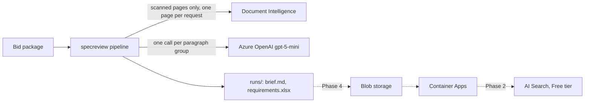

# Azure: setup, costs, and guardrails

Since 2026-10-29 the project runs on Azure for everything. Tests never touch Azure: they run offline in mock mode, with no keys. Only real runs use the services below. The old Explorer cluster guide is in [EXPLORER.md](EXPLORER.md); nothing here depends on it.

## What runs on Azure

| Service | Used for | Phase | Bills by |
|---|---|---|---|
| **Azure OpenAI** chat, deployment `gpt-5-mini` | Requirement and permit-limit extraction | 1b | Tokens |
| **Document Intelligence**, prebuilt-read model, free F0 tier | OCR of scanned pages only | 1b | Pages; 500 free a month |
| **Azure OpenAI** embeddings, `text-embedding-3-small` | Knowledge-base vectors | 2 | Tokens |
| **Azure AI Search**, Free tier | Evidence search | 2 | Nothing on the Free tier |
| **Container Apps**, consumption plan | Hosting the app and API | 4 | Usage above a monthly free grant |
| **Blob storage** | Runs, files, review database | 4 | Storage, in cents |

Nothing in Phase 1b bills by the hour.



## Setup, done once by you

1. **Create a resource in [Microsoft Foundry](https://ai.azure.com)** (formerly Azure AI Foundry) that can deploy OpenAI models. Pick a region where `gpt-5-mini` is offered as Global Standard. Foundry shows this when you deploy; I couldn't confirm a region list.
2. **Deploy `gpt-5-mini`**:
   - deployment type **Global Standard**;
   - deployment name **`gpt-5-mini`**;
   - note the tokens-per-minute (TPM) quota it shows, since that sets how long a large package takes (see "Quota" below).
3. **Create a Document Intelligence resource** on the **F0 (free)** tier. This step is optional: without it, `PROVIDER_OCR=local` uses Tesseract.
4. **Set budget alerts** at $25, $50, and $75 under Cost Management. They only notify you; they don't stop spending. On a new subscription they can take up to 48 hours to become available. The Azure for Students subscription itself stops when the $100 credit runs out ([Azure for Students costs](https://learn.microsoft.com/en-us/azure/education-hub/navigate-costs)).
5. **Fill in `.env`.** Copy `.env.example` to `.env` (it's gitignored), then set:

   ```
   PROVIDER_LLM=azure
   PROVIDER_OCR=azure
   AZURE_OPENAI_ENDPOINT=https://<resource>.openai.azure.com
   AZURE_OPENAI_KEY=<key>
   AZURE_OPENAI_CHAT_DEPLOYMENT=gpt-5-mini
   AZURE_OPENAI_REASONING_EFFORT=minimal
   AZURE_DOCINTEL_ENDPOINT=https://<resource>.cognitiveservices.azure.com
   AZURE_DOCINTEL_KEY=<key>
   LLM_PRICE_INPUT_PER_MTOK=0.25
   LLM_PRICE_OUTPUT_PER_MTOK=2.00
   ```

   - **Endpoint:** use the Azure OpenAI endpoint (it ends in `openai.azure.com`), not a Foundry project URL. The code adds `/openai/v1/` itself.
   - **Prices:** leaving them blank makes every run report a cost of $0.
6. **Check it:** `uv run specreview azure-check`. It makes one tiny call to each configured service. For chat it prints the model, tokens, and cost, plus the deployment's tokens-per-minute limit when Azure sends it. For Document Intelligence it prints how many lines it read.

## Choosing the model

- **`gpt-5-mini` is the default.** It is generally available on Azure until 2027-02-09 ([retirement schedule](https://learn.microsoft.com/en-us/azure/foundry/openai/concepts/model-retirement-schedule)). Most trackers price it at $0.25 per million input tokens and $2.00 per million output tokens; one lists $0.275 and $2.20 for some regions ([Finout](https://www.finout.io/blog/azure-openai-pricing-6-ways-to-cut-costs), [Cloudprice](https://cloudprice.net/models/gpt-5-mini)).
- **Reasoning effort.** GPT-5 models bill hidden reasoning as output tokens, so the default is `minimal`. If extraction misses requirements, raising it to `low` is the first lever before writing a new prompt.
- **`gpt-5.4-mini` is a newer option.** It is generally available until 2027-09-21 (same schedule). Its price is unconfirmed. Switching is a `.env` change: deploy it, then set `AZURE_OPENAI_CHAT_DEPLOYMENT`.
- **Lock the model at the first real scorecard.** Dev and test scorecards must use the same deployment, prompts, and settings.

## What a run costs

These are estimates from measured call counts and prompt sizes, using gpt-5-mini prices. The output share is the least certain part.

| Package | LLM calls | Input tokens | Output tokens | Cost |
|---|---|---|---|---|
| Lakeview (dev, 154 pages) | about 78 | 40–65K | 40–60K | $0.10–0.15 |
| Mountain Regional (577 pages) | about 734 | 0.85–1.1M | 0.8–1.1M | $1.50–2.50 |

- **Output dominates.** The model gives each of Mountain Regional's 11,370 flagged sentences a disposition, and writes a record for each requirement.
- **Document Intelligence:** Lakeview has one scanned page and Mountain Regional none, so both are inside the free 500 pages a month ([pricing](https://azure.microsoft.com/en-gb/pricing/details/ai-document-intelligence/)).
- **Phase 1b total**, with up to 3 tuning rounds on Lakeview and one or two Mountain Regional runs: under $10.
- **Re-runs of unchanged input are free.** Replies are cached in `.cache/llm/`, and Document Intelligence results in `.cache/docintel/`.
- **Later phases:** embeddings come to under $1, and AI Search Free costs $0. The Container Apps free grant covers about 100 hours a month of a small container ([billing](https://learn.microsoft.com/en-us/azure/container-apps/billing)). Blob storage costs cents.

## Quota

The tokens-per-minute quota, not money, is the real limit.

- **Mountain Regional:** about 1.7–2.2M tokens. That takes about 40 minutes at 50K tokens per minute, 3–4 hours at 10K, and more than a day at 1K.
- **Lakeview:** a few minutes at any quota.
- **Rate limits are handled.** The SDK retries rate-limit errors (HTTP 429) on its own, honoring `Retry-After`, and at most 4 calls are in flight (`LLM_MAX_CONCURRENCY`).
- **Interrupted runs resume.** An interrupted run picks up from the cache when you run it again.
- **If the quota is too low,** request more in Foundry, or run Mountain Regional overnight.

Azure reports the deployment's limit in the `x-ratelimit-limit-tokens` response header ([quota docs](https://learn.microsoft.com/en-us/azure/foundry-classic/openai/how-to/quota?tabs=rest)). `azure-check` prints it when the header is present.

## Guardrails

1. **Mini models only,** with the lowest reasoning effort that works. Never a flagship model for routine calls.
2. **Cache everything.** LLM replies, Document Intelligence pages, and ingest results are all cached by a hash of their input. Failed calls are never cached, so a re-run retries them.
3. **Document Intelligence only for scanned pages, one page per request.**
   - The free tier reads only the first two pages of a request ([service limits](https://learn.microsoft.com/en-us/azure/ai-services/document-intelligence/service-limits)).
   - Born-digital pages and their tables stay on free PyMuPDF and pdfplumber.
4. **Free tiers only:** AI Search Free and the Container Apps grant. Never provisioned throughput (PTU), and never a paid Search tier; both bill every hour.
5. **Let containers scale to zero** (Phase 4). Keep one copy running only on interview day.
6. **Push images to GitHub Container Registry,** which is free for public repos, rather than Azure Container Registry.
7. **Keep the budget alerts on,** and delete the resource group after the demo.

## Troubleshooting

| You see | Cause and fix |
|---|---|
| `Missing settings in .env: …` | The named keys are blank. Fill them in. |
| `chat failed: …401…` | Wrong `AZURE_OPENAI_KEY`, or a key from a different resource than the endpoint. |
| `chat failed: …404…` | `AZURE_OPENAI_CHAT_DEPLOYMENT` doesn't match the deployment name in Foundry, or the endpoint is a project URL. |
| `Document Intelligence refused the key (HTTP 401/403)` | Wrong `AZURE_DOCINTEL_KEY` or endpoint. Scanned pages stay `needs_ocr`, and the run continues. |
| `every LLM call failed …` (exit 1) | Usually a bad key or deployment. Run `uv run specreview azure-check`. |
| A run is slow, or the log shows many retries | The quota is too low (see "Quota"). Let it run; the cache keeps finished work. |

## Sources

Checked on 2026-10-30. Microsoft's pricing pages didn't show figures when checked, so prices come from third-party trackers. Confirm them in the [Azure pricing calculator](https://azure.microsoft.com/en-us/pricing/calculator/) before relying on them.

- [Model retirement schedule (Microsoft Foundry)](https://learn.microsoft.com/en-us/azure/foundry/openai/concepts/model-retirement-schedule)
- [Azure OpenAI quotas and rate-limit headers (Microsoft Learn)](https://learn.microsoft.com/en-us/azure/foundry-classic/openai/how-to/quota?tabs=rest)
- [Document Intelligence service limits (Microsoft Learn)](https://learn.microsoft.com/en-us/azure/ai-services/document-intelligence/service-limits)
- [Document Intelligence pricing (Microsoft)](https://azure.microsoft.com/en-gb/pricing/details/ai-document-intelligence/)
- [Azure OpenAI pricing (Microsoft)](https://azure.microsoft.com/en-us/pricing/details/azure-openai/), with trackers [Finout](https://www.finout.io/blog/azure-openai-pricing-6-ways-to-cut-costs) and [Cloudprice](https://cloudprice.net/models/gpt-5-mini)
- [Billing in Azure Container Apps (Microsoft Learn)](https://learn.microsoft.com/en-us/azure/container-apps/billing)
- [Choose a service tier for Azure AI Search (Microsoft Learn)](https://learn.microsoft.com/azure/search/search-sku-tier)
- [Manage costs for Azure for Students (Microsoft Learn)](https://learn.microsoft.com/en-us/azure/education-hub/navigate-costs)
