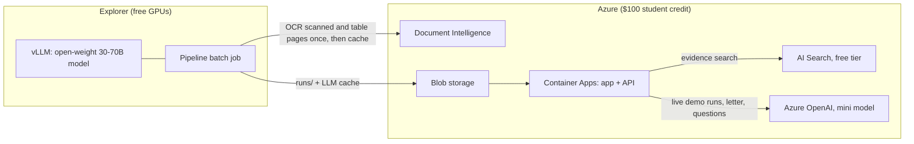

# Explorer and Azure: setup and cost plan

This project runs in three places:

- **Northeastern's Explorer cluster** does the heavy, repeatable model work for free.
- **Azure** hosts the product and the managed AI services the demo shows.
- **A saved-response cache** makes every re-run of unchanged input cost nothing.

Part 1 connects Explorer so Claude Code can run cluster commands. Part 2 explains how the work is split between Explorer and Azure to keep the bill low.

Replace `<user>` with your Northeastern username and `<key>` with the key file name Research Computing (RC) gives you.

---

## Part 1: Connect Explorer to Claude Code

### Why

Phase 1 onward needs many round trips to the cluster: starting the model server, test runs, and copying results back. Claude Code can do these itself once it can log in without a password prompt.

### Deadline

From **November 6, 2026 at 9 a.m.**, Explorer only accepts SSH with keys that RC generates. Northeastern passwords stop working for SSH then. Set up the keys now. See [SSH instructions for Explorer](https://rc.northeastern.edu/2026/10/23/ssh-instructions-for-explorer/).

### Steps, done once by you

1. **Download your RC key pair.**
   - Sign in at https://ood.explorer.northeastern.edu and open the **File Browser**.
   - Go to your home folder, then `.ssh`. Turn on "show hidden files" if you don't see it.
   - Download both files: `<user>-<timestamp>` (the private key) and `<user>-<timestamp>.pub`.

2. **Put them in `~/.ssh` on your Mac and lock down the permissions.** Claude Code can't read your Downloads folder, so move the files yourself.
   ```bash
   mv ~/Downloads/<key> ~/Downloads/<key>.pub ~/.ssh/
   chmod 600 ~/.ssh/<key>
   chmod 644 ~/.ssh/<key>.pub
   ```

3. **Log in once from your own Terminal app**, so the cluster's host key gets saved:
   ```bash
   ssh -i ~/.ssh/<key> <user>@login.explorer.northeastern.edu
   ```
   Type `yes` at the host-key prompt. Note whether it asks for a password or Duo, then type `exit`.

4. **Tell Claude Code** two things: the key file name, and whether step 3 asked for a password or Duo.

### What Claude Code does next

It tests a login that cannot prompt:

```bash
ssh -i ~/.ssh/<key> -o BatchMode=yes <user>@login.explorer.northeastern.edu hostname
```

| Result | What happens |
|---|---|
| Prints a hostname such as `explorer-02` | **Connected.** Claude Code runs cluster commands itself from here on. |
| Fails because Duo or a password is needed on every login | Use the **shared connection** below. |
| You'd rather not give access | Run the commands yourself and paste the output into the chat. |

If Claude Code asks permission to run an `ssh` command, approve it. You can also add an allow rule for `ssh -i ~/.ssh/<key>` in your Claude Code settings.

### Fallback: shared connection, only if Duo prompts on every login

You add this yourself. Claude Code isn't permitted to edit `~/.ssh/config`.

```
Host explorer
  HostName login.explorer.northeastern.edu
  User <user>
  IdentityFile ~/.ssh/<key>
  ControlMaster auto
  ControlPath ~/.ssh/cm-%C
  ControlPersist 8h
  ServerAliveInterval 60
```

Then run `ssh explorer` once in your own Terminal and complete Duo. For the next 8 hours, Claude Code's `ssh explorer '<command>'` calls reuse that login. Close it early with `ssh -O exit explorer`.

### Safety

- The private key never leaves your Mac. RC asks that you never copy it to shared or lab machines.
- To revoke access, regenerate the key in Open OnDemand.
- Everything Claude Code runs on the cluster shows up in your shell history there.

### First checks Claude Code runs on Explorer

```bash
sinfo -o "%20P %8a %10l %50G" | grep -iE 'partition|gpu'                # GPU partitions, time limits, GPU types
sacctmgr -nP show assoc user=$USER format=account,partition,qos         # what you're allowed to use
srun -p gpu --gres=gpu:1 --mem=16G --time=00:10:00 --pty nvidia-smi     # the GPU you actually get
df -h ~ /scratch/$USER                                                  # space for model weights
srun -p short --time=00:05:00 curl -sI https://pypi.org | head -1      # can compute nodes reach the internet?
```

The GPU's memory decides the model size:

| GPU memory | Model size |
|---|---|
| 80 GB or more | 30–70B |
| 32–48 GB | 14–32B |
| 16 GB or less | Not worth it over a laptop |

---

## Part 2: Splitting work between Azure and Explorer

**The rule:** anything that runs many times and costs tokens goes to Explorer. Anything the interviewer sees running, or that Azure gives free or nearly free, stays on Azure.



### Where each piece runs

| Piece | Where | Why | Estimated cost for the week |
|---|---|---|---|
| Bulk extraction and judging, every scored dev and test run | **Explorer**, with vLLM serving a 30–70B open-weight model | Millions of tokens, no quota, free | **$0** |
| OCR and layout | **Azure Document Intelligence** | It shows Azure, and it's run once per document then cached. Born-digital pages use free PyMuPDF; only scanned and table-heavy pages need it | **$0–25** (about $10 per 1,000 pages; 500 pages a month free) |
| Embeddings for the knowledge base | **Azure OpenAI** embeddings | The knowledge base is small and is embedded once | **Under $1** |
| Evidence search | **Azure AI Search, free tier** | It shows Azure and costs nothing | **$0** |
| App and API hosting | **Azure Container Apps**, stopping when idle | The live demo URL. About 100 hours a month of a small container are free | **$0–5** |
| Files, runs, and the review database | **Azure Blob storage** | The app reads the results Explorer produced | **Cents** |
| Live run during the interview | **Azure OpenAI mini model** if quota allows; otherwise a free hosted API (Groq or Cerebras); otherwise replay of a saved run | Fast, and visibly Azure | **Cents** |
| Drafting the letter and clarification questions | **Azure OpenAI mini model** | Only a few calls, so even a tiny student quota works | **Cents** |
| Tests and CI | **Mock provider** on GitHub Actions | No network, no keys, free on a public repo | **$0** |

**Estimated total:** about $15–40 of the $100 Azure credit, and $0 on Explorer.

### If the Azure student quota turns out to be healthy

Benchmark both options on the Lakeview package on day 1: Azure OpenAI's mini model, at about $8–25 for a week of runs, against the Explorer model. Keep whichever scores better.

**Then lock that model.** The dev scorecards and the final test run must all use the same model, prompts, and settings.

### Guardrails that keep the bill small

1. **Use mini models only** for routine calls, never a flagship. GPT-5-mini bills its hidden reasoning as output tokens, so set its reasoning effort to the lowest setting.
2. **Cache every LLM response and every Document Intelligence result**, keyed by a hash of the input. Re-runs of unchanged input cost $0, and a run cut off by a time limit resumes for free.
3. **Send each document to Document Intelligence once.** Use the `pages` parameter to send only the pages that need OCR or table extraction.
4. **Use free tiers only:** AI Search Free and the Container Apps monthly grant. Never provisioned throughput (PTU), and never a paid Search tier, which bills every hour.
5. **Let containers stop when idle.** Set a minimum of one running copy only on interview day.
6. **Push images to GitHub Container Registry** (free for public repos) instead of Azure Container Registry.
7. **Set budget alerts** at $25, $50, and $75. A student subscription stops when the credit runs out, and losing it mid-week would be worse than the bill.
8. **Delete the resource group after the demo.**

### Explorer tips

- **Never run model servers on login nodes.** Start vLLM inside a Slurm job and point the pipeline at `http://localhost:8000/v1` on the same node.
- **Keep model weights in `/scratch/<user>`**, not in your home folder.
- **Expect GPU jobs to hit time limits.** The cache makes it safe to split one package across several jobs.
- **Copy results back** with `rsync -av <user>@login.explorer.northeastern.edu:<path>/runs/ runs/`, then upload them to Blob storage for the hosted app.
- **If compute nodes have no outbound internet**, check this with the last Part 1 command. In that case, call Document Intelligence from your Mac or Azure and copy the cached results to Explorer.
- **Prefer models with no license gate**, such as most Qwen releases. Llama models need a Hugging Face token and an accepted license.

### Sources

- [SSH instructions for Explorer (RC, October 2026)](https://rc.northeastern.edu/2026/10/23/ssh-instructions-for-explorer/)
- [All About Explorer and the New H200 GPUs (RC)](https://rc.northeastern.edu/?p=7231)
- [Working with GPUs (RC docs)](https://rc-docs.northeastern.edu/en/explorer-main/gpus/index.html)
- [Azure OpenAI pricing (Microsoft)](https://azure.microsoft.com/en-us/pricing/details/azure-openai/)
- [Azure Document Intelligence pricing (Microsoft)](https://azure.microsoft.com/zh-cn/pricing/details/document-intelligence/)
- [Billing in Azure Container Apps (Microsoft Learn)](https://learn.microsoft.com/en-us/azure/container-apps/billing)
- [Choose a service tier for Azure AI Search (Microsoft Learn)](https://learn.microsoft.com/azure/search/search-sku-tier)
- [Azure for Students quota reports (Microsoft Q&A)](https://learn.microsoft.com/en-ie/answers/questions/2224916/azure-ai-foundry-quota-insufficient-issues-student)

The prices above come from third-party price trackers checked in October 2026, because Microsoft's own pages didn't show the numbers. Confirm them in the Azure pricing calculator before relying on them.
