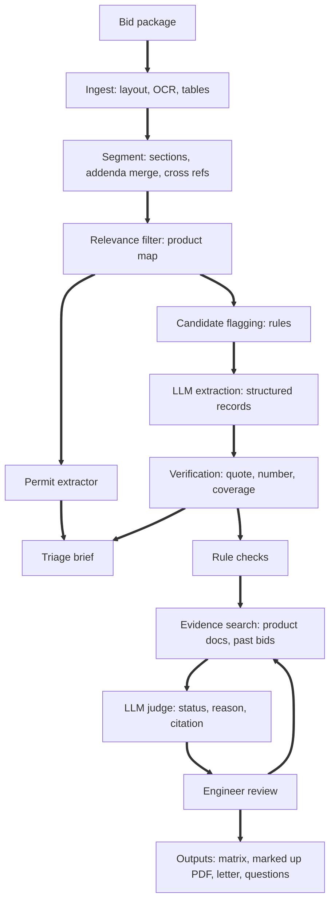

# Spec Review Copilot: Project Spec

## 1. Goal

Build a working prototype that helps a water and wastewater equipment manufacturer review municipal bid packages. Packages run to hundreds of pages. The tool finds the sections that matter to the manufacturer, extracts every requirement with its exact page, checks each requirement against product capabilities, and drafts bid outputs. An engineer approves everything.

This is a proof of value, not a product. It runs on public and synthetic data, and it measures its own accuracy.

The core AI problem: never miss a requirement in a long package, and prove where every item came from.

## 2. Users and pains

Primary user: applications or proposal engineer. Secondary users: sales and product managers.

Pains, in order of business impact:

1. Engineer time spent reading hundreds of pages to find a few relevant sections.
2. Margin erosion: a requirement buried deep in the package is missed at bid time and becomes a cost after award.
3. Disqualification: a missed form, deadline, or mandatory requirement makes the bid non responsive.
4. Specs written around a competitor, which must be challenged during the clarification window.
5. Addenda that change requirements and deadlines after the RFP is issued.
6. Knowledge scattered across many legacy brands, so the same answers get rewritten.

## 3. Scope

In scope: ingest, segmentation, addenda merge, cross references, relevance filtering, requirement extraction with verification, permit limit extraction, triage brief, compliance matching, engineer review app, outputs, evaluation.

Out of scope: equipment sizing calculations, pricing, final bid decisions, integration with real company systems, user authentication, Postgres (SQLite only), and the EPA ECHO dataset. The stretch packages are optional.

The prototype is an interview demo, built in one week: an end-to-end product that really solves the problem, from uploading a package to an approved compliance matrix. It runs on open-source tools. Azure providers come later, behind the same interfaces, once Azure access is available. Cut only what is complex and invisible in the demo.

## 4. Data

All sources are listed in data/sources.yaml. Raw files go in data/raw/ (gitignored). Commit the download script, never the files.

### Dev set (build and tune on these only)

* Mountain Regional Water, Utah: membrane procurement specs and board memo
* UFGS Division 46 guide specifications (public domain), for splitter and extractor tests
* Lakeview synthetic package (section 4.1)

### Test set (held out, labeled by hand, run once at the end)

* City of Manor, Texas: full wastewater plant spec book. Tests finding a few relevant sections in a huge book.
* City of Sandy, Oregon: membrane equipment RFP with five addenda. Tests the addenda merge.
* Avila Beach, California: MBR preselection RFP with scoring tables and technical data forms. Tests tables and forms.

### Stretch

Port Byron NY bidder Q&A (reference for what real clarification questions look like), Fargo RO RFP, Ronan MT microfiltration procurement, Wheeling WV bid book.

### Lake and permit context

EPA Lake Champlain phosphorus study (plant list with target total phosphorus limits), Vermont discharge permits, EPA ECHO permit limit data (optional, very large).

### Knowledge base

The manufacturer's public product literature: screens, clarifiers, aeration, biological systems, SiC membranes, PFAS. The project owner builds data/knowledge/capabilities.csv by hand from these documents, one row per product line and parameter, with source URL, page, and basis (guaranteed, typical, or claim) for every value. Exclude anything from the divested electronics business.

Synthetic and clearly labeled fictional: data/knowledge/past_exceptions.csv (past bid exceptions and clarifications) and standard terms.

### 4.1 Lakeview synthetic package

scripts/make_lakeview.py creates the PDFs and the golden labels from one source of truth, so the labels are exact.

Scenario: fictional town of Lakeview upgrading a wastewater plant that discharges to a lake under a new total phosphorus limit of 0.1 mg/L.

Contents:

* Equipment preselection RFP: scope, pilot testing, warranty, pricing form, references (at least three installations), bid date, and an approved equal deadline 14 days before the bid date.
* Division 46 sections for screening, clarifier, and membrane filtration, each with Part 1 General, Part 2 Products, Part 3 Execution.
* A Division 01 submittals section that the equipment sections reference.
* An NPDES style permit excerpt with total phosphorus, ammonia, BOD, and TSS limits.
* Addendum 1 that changes two requirements and moves the bid date.
* Realistic irrelevant sections (sitework, electrical, concrete) so the package is at least 150 pages.

Planted traps, each recorded in the golden file:

1. A mandatory requirement buried deep inside a long section.
2. A requirement only reachable through a cross reference to Division 01.
3. A requirement that lives in a table row.
4. A named competitor with an "or equal" clause.
5. A total phosphorus limit of 0.1 mg/L, where the product literature only supports below 0.2 mg/L. Expected status: needs_engineer.
6. A "should" statement that must not be marked mandatory.
7. A requirement changed by the addendum, where only the new version is valid.

## 5. Architecture



Layers:

1. Interface: Streamlit review app and the specreview CLI.
2. API: FastAPI service that runs packages as background jobs, with progress, and serves results to the app. A real package takes minutes on a local model, so the app must not block on it.
3. Pipeline: the stages above.
4. Services and storage: OCR provider, LLM provider, SQLite, vector index, file store.

Providers are pluggable through config:

* Mock: deterministic fixtures, for tests and CI only.
* Local (open source, the demo default): PyMuPDF and pdfplumber, Tesseract OCR for scanned pages, an open-weight chat model and an embedding model served by Ollama, ChromaDB. The development machine is an Apple M2 with 8 GB, so the chat model must fit in roughly 3 to 8B parameters.
* Azure (later, once access is available): AI Document Intelligence (layout model), Azure OpenAI (chat and embeddings), optionally Azure AI Search.

Accuracy numbers always come from a real chat model, so the local Ollama chat provider lands in Phase 1 and every dev scorecard is measured with it. Never build mock fixtures from golden labels, and never report mock-mode metrics as accuracy.

## 6. Repo layout

```
spec_review/
  config.py
  models.py
  llm/            client.py, mock.py, ollama.py, azure.py
  ingest/         pdf_local.py, ocr_tesseract.py, azure_docintel.py, normalize.py, tables.py
  segment/        sections.py, addenda.py, xrefs.py
  filter/         product_map.yaml, relevance.py
  extract/        candidates.py, requirements.py, permits.py, verify.py, prompts/
  brief/          build.py
  knowledge/      capabilities.py, index.py
  match/          rules.py, evidence.py, judge.py, gate.py, prompts/
  outputs/        matrix_xlsx.py, markup_pdf.py, letter_docx.py, questions.py, addendum_diff.py
  eval/           golden.py, metrics.py, scorecard.py
  api/            main.py
  cli.py
app/              streamlit_app.py
scripts/          download_sources.py, make_lakeview.py, demo.sh
data/             sources.yaml, raw/ (gitignored), knowledge/, golden/dev/, golden/test/
runs/             (gitignored)
tests/
```

## 7. Data models (the contract between stages)

Once Phase 0 lands, spec_review/models.py is the source of truth for field types; this section is the starting point. doc_id is the PDF file name without extension, relative to the package directory. page is the 1-based page index in that PDF, not the printed page label.

**Block:** doc_id, page, bbox, text, kind (paragraph, heading, table_row, list_item)

**Section:** section_id, number, title, numbering_style (csi, legacy, front_end), part (general, products, execution, none), doc_id, page_start, page_end, blocks, superseded_by

**Candidate:** candidate_id, section_id, paragraph_path, page, sentence, triggers (shall, must, required, minimum, maximum, number_with_unit)

**Requirement:** req_id, doc_id, section_number, section_title, paragraph_path, page, bbox, source_text (verbatim), category, parameter, operator, value, unit, mandatory, named_manufacturer, or_equal_allowed, linked_sections, from_addendum, confidence, candidate_ids

Categories: performance, effluent_limit, design_basis, material, certification, testing_piloting, warranty, commercial, submittal, schedule, domestic_content, qualification

**CandidateDisposition:** candidate_id, outcome (requirement, not_requirement), req_ids, reason

**PermitLimit:** parameter, limit_type (monthly_avg, weekly_avg, daily_max, annual_load), value, unit, season, doc_id, page, source_text

**Capability:** product_line, parameter, min_value, max_value, unit, value_text, basis (guaranteed, typical, claim), source_url, source_page

**Evidence:** evidence_id, source (capability, product_doc, past_exception), ref, page, text, score

**MatchResult:** req_id, status (comply, comply_with_clarification, deviation, needs_engineer, not_applicable), method (rule, llm), reason, evidence_ids, confidence

**ReviewDecision:** req_id, final_status, note, reviewer, timestamp

**Brief:** package_id, relevant_sections (number, title, doc_id, page_start, page_end, product_line), key_requirements, deadlines, required_forms, red_flags, permit_limits, addenda_changes. Every brief line (key requirements, deadlines, required forms, red flags, addenda changes) is a cited item with text, doc_id, and page, plus section_number and req_id when known.

## 8. Pipeline details

**8.1 Ingest.** Extract text with block coordinates using PyMuPDF. Extract tables with pdfplumber and convert each row into a labeled line, like "Peak flow: 4.2 MGD". If a page has very little text, mark it as scanned. In local mode, OCR scanned pages with Tesseract; in Azure mode, send them to Document Intelligence. A page with no text and no images is blank, not scanned. A page that still has no text after OCR is recorded as needs_ocr and counted in the coverage report.

**8.2 Segment.** Detect section headers in CSI format ("SECTION 46 21 00"), legacy formats ("SECTION 11300", "Section 13226A"), and front end documents (Division 00 and 01). Build paragraph paths (1.01, A, 1, a) and track Part 1, 2, and 3.

**8.3 Addenda.** Parse addendum instructions such as "Delete paragraph 2.03.B and replace with" or "Revise the bid date to". Apply them in order. The newest version wins. Keep the history, and flag every changed requirement in the brief.

**8.4 Cross references.** Detect section numbers inside text, link the referenced section, and include its requirements once without duplicates.

**8.5 Relevance filter.** spec_review/filter/product_map.yaml maps section number prefixes and keywords to product lines. Always include bidding instructions, bid forms, submittals, warranties, and domestic content sections. Use the LLM only for unclear sections. Favor recall, and log every excluded section with a reason.

**8.6 Candidates.** Rules flag every sentence containing shall, must, required, minimum, maximum, not less than, not more than, or a number with units.

**8.7 Extraction.** One LLM call per paragraph group, with section context. Structured output. Split compound sentences into separate records. Copy source_text exactly. Prompt template: Appendix A.

**8.8 Verification.**

1. Quote check: source_text must appear on the cited page (fuzzy ratio of at least 0.95 using rapidfuzz). If it fails, reject the record and log it.
2. Number check: every numeric value in the record must appear in source_text. If it fails, reject the record.
3. Coverage check: every candidate must have a disposition. Any candidate without one becomes a needs_engineer item. Report the count.
4. Records below the confidence threshold are flagged.

**8.9 Permit extractor.** A separate prompt and schema for permit pages.

**8.10 Brief.** One page markdown plus Excel: relevant sections with pages, key requirements, deadlines, required forms, red flags (named manufacturers, pilot testing, bonds, liquidated damages, domestic content, experience minimums), permit limits, and addenda changes. Every line links to its page.

**8.11 Rule checks.** Unit conversion with pint. Numeric ranges against capabilities, certification sets, material lists. When a rule is decisive, skip the LLM and record method = rule. A rule may decide on its own only against capabilities with basis = guaranteed. Typical and claim values never decide; they go to the judge as evidence.

**8.12 Evidence search.** Hybrid keyword search (rank_bm25) plus vector search (ChromaDB locally) over capabilities, product docs, and past exceptions. Return the top results with scores.

**8.13 Judge.** The LLM receives the requirement and its evidence and returns status, reason, evidence ids, and confidence. Enforced in code: comply or comply_with_clarification without a supporting evidence id becomes needs_engineer. Prompt template: Appendix B.

**8.14 Gate.** Anything below the confidence threshold becomes needs_engineer.

**8.15 Review app.** Streamlit pages: Brief, Checklist (filters by status, category, and section), Source viewer (rendered page with the requirement highlighted), Addenda changes. The engineer approves or edits each status. Decisions are saved. Accepted deviations are appended to data/knowledge/review_exceptions.csv, kept apart from the fictional past_exceptions.csv. specreview eval never reads review_exceptions.csv, so review history cannot change dev or test scores. A labeling helper page lets the project owner create golden labels by hand, with no model prefill.

**8.16 Outputs.** Excel compliance matrix (openpyxl), marked up PDF with highlights and C, D, or R margin notes (PyMuPDF), exceptions and clarifications letter (the python docx library), clarification questions list, addendum diff report.

## 9. Evaluation

**Golden format:** one JSON file per package with requirements (doc_id, section_number, paragraph_path, page, category, parameter, value, unit, mandatory), relevant_sections, deadlines, required_forms, red_flags (each with doc_id and page), and expected_status (Lakeview only).

**Matching rule:** a predicted requirement matches a golden one when they cite the same doc_id, the normalized section number and paragraph path are equal, and the normalized value matches. When there is no value, text similarity of at least 0.8 counts. Matching is one to one: each golden requirement matches at most one prediction, best similarity first, and extra predictions count against precision.

Normalization: section numbers drop spaces and periods and are uppercased (46 21 00 = 462100). Paragraph paths drop leading zeros in each numeric part and uppercase letters (2.03.B.4 = 2.3.B.4). Values compare as numbers when both parse, with thousands separators removed and spelled numbers one to twenty converted (three = 3). Units compare case-insensitively, with no conversion.

**Labeling protocol** (for data/golden/test/, agreed before labeling starts):

* Label relevant_sections for the whole package: every section that covers the manufacturer's product lines, plus bidding instructions, bid forms, submittals, warranties, and domestic content.
* Label requirements only inside relevant sections, including requirements reached through cross references.
* One record per obligation, split the same way as Appendix A rule 2.
* page is the 1-based PDF page index, not the printed page label.
* A requirement changed by an addendum is labeled once, in its final form, with from_addendum set.

**Metrics:**

* Section filter recall
* Requirement recall and precision
* Mandatory requirement recall
* Deadline and required form recall
* Citation accuracy (the cited page really contains source_text)
* Silent coverage drops
* Status accuracy (Lakeview)
* Tokens, latency, and cost per package

**Targets, set before testing:**

* Section filter recall: 100%
* Mandatory requirement recall: at least 95%
* Deadline and required form recall: 100%
* Citation accuracy: at least 98%
* Silent coverage drops: zero

**Rules:** build on the dev set. The test set is labeled by hand by the project owner, never by the model. `specreview eval test` runs only in Phase 4, and results are reported as they are.

## 10. Phases and acceptance criteria

**Phase 0: Setup (1 to 2 days)**

* uv run pytest passes with no network and no keys.
* All models in section 7 exist and import cleanly.
* The download script fetches every direct PDF link in sources.yaml and prints instructions for landing pages.
* The mock LLM returns deterministic fixtures.
* CI runs tests on every push.

**Phase 1: Read (days 1 to 3)**

* Lakeview: section filter recall of 100% and zero silent coverage drops.
* Quote and number checks run on every record, with pass rates reported.
* The local Ollama chat provider works behind spec_review/llm/client.py, and the Phase 1 dev metrics come from a real-model run.
* Scanned pages are OCRed with Tesseract, and blank pages are reported as blank.
* The brief lists every planted deadline, required form, and red flag with its page.
* Requirement recall on Lakeview is reported.
* Mountain Regional runs end to end and produces brief.md and requirements.xlsx.

**Phase 2: Judge (day 4)**

* Every match result has a method, reason, and confidence.
* Every comply has at least one supporting evidence id.
* The phosphorus trap comes out as needs_engineer.
* Status accuracy on Lakeview is reported, with every wrong item listed.

**Phase 3: Review and outputs (days 5 and 6)**

* The full review flow works on Lakeview, including its addendum.
* All five outputs generate correctly.
* Review decisions persist across restarts.
* The labeling helper works with no model prefill.

**Phase 4: Test and polish (day 7)**

* The test scorecard is saved and reported as is.
* Docker compose runs the API and the app, with Ollama, on one machine.
* Azure providers are added behind the same interfaces only if Azure access is available; the demo does not depend on them.
* README is complete, with honest results and limitations.

## 11. Config

.env keys:

```
PROVIDER_OCR=local            # local (Tesseract) or azure
PROVIDER_LLM=mock             # mock, ollama, or azure
OLLAMA_HOST=http://localhost:11434
OLLAMA_CHAT_MODEL=
OLLAMA_EMBED_MODEL=
AZURE_DOCINTEL_ENDPOINT=
AZURE_DOCINTEL_KEY=
AZURE_OPENAI_ENDPOINT=
AZURE_OPENAI_KEY=
AZURE_OPENAI_CHAT_DEPLOYMENT=
AZURE_OPENAI_EMBED_DEPLOYMENT=
AZURE_SEARCH_ENDPOINT=
AZURE_SEARCH_KEY=
CONFIDENCE_THRESHOLD=0.6
```

## Appendix A: Extraction prompt (extract_v1.md)

```
You extract requirements from one part of a construction specification for water or wastewater equipment.

Context:
Section {section_number} {section_title}, {part}, paragraph {paragraph_path}, page {page}.

Text:
{text}

Candidate sentences flagged by rules:
{candidates}

Rules:
1. Use only the text above. Never add outside knowledge or assume values.
2. Create one record per requirement. Split sentences that contain several requirements.
3. Copy source_text exactly from the text, character for character.
4. Values and units must appear in source_text. Do not convert units.
5. mandatory is true for "shall", "must", and "is required". It is false for "should", "may", and "recommended".
6. Record any named manufacturer, and whether "or equal" is allowed.
7. List any referenced sections in linked_sections.
8. For every candidate, return a disposition: requirement (with record ids) or not_requirement (with a short reason).
9. If unsure, set confidence below 0.6 instead of guessing.

Return JSON that matches the schema.
```

## Appendix B: Judge prompt (judge_v1.md)

```
You check whether a manufacturer's equipment meets one specification requirement.

Requirement:
{requirement_json}

Evidence (each with id, source, and page):
{evidence}

Rules:
1. Decide only from the evidence. If the evidence does not clearly support compliance, choose needs_engineer.
2. comply and comply_with_clarification must cite at least one evidence id that supports the decision.
3. deviation must say what differs and cite the evidence.
4. Brochure claims like "many plants achieve" are not guarantees. Treat them as partial support only.
5. Never invent capabilities, numbers, or certifications.

Return JSON with: status, reason (two sentences at most), evidence_ids, confidence.
```
